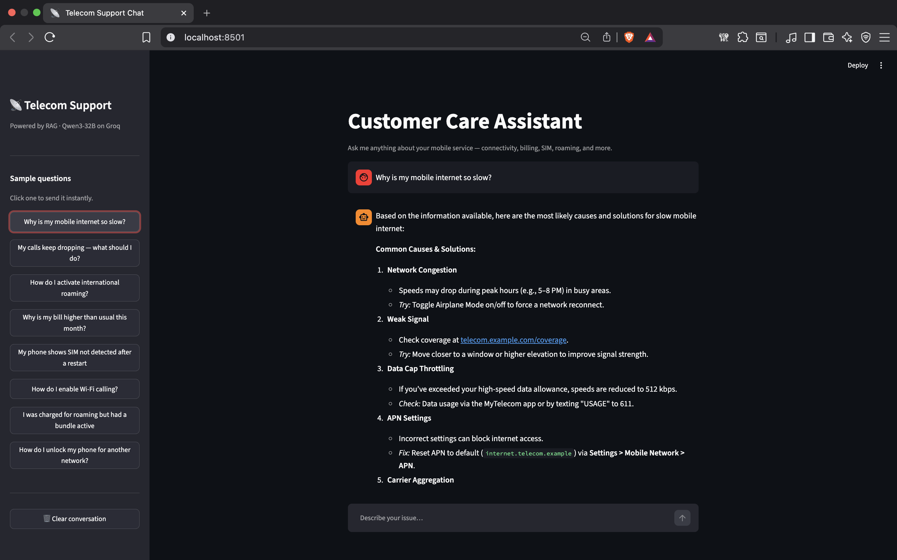

# RAG Telecom Chatbot

A Retrieval-Augmented Generation (RAG) customer care chatbot for telecom support. It answers questions about mobile connectivity, billing, SIM issues, roaming, and related service problems by retrieving relevant context from FAQ rows, resolved tickets, and a telecom guide, then generating responses with Qwen3-32B via Groq.

## Architecture

```
User question
     │
     ▼
Merged Retriever (top-k from each store + FAQ fallback)
  ├── ChromaDB · faq        (FAQ entries from CSV)
  ├── ChromaDB · tickets    (resolved support tickets from SQLite)
  └── ChromaDB · guides     (PDF guide chunks)
     │
     ▼
ChatPromptTemplate → gpt-oss-120b (Groq) → Answer
```

**Embedding model:** `sentence-transformers/all-MiniLM-L6-v2` (runs locally via HuggingFace)  
**LLM:** `openai/gpt-oss-120b` served by [Groq](https://groq.com)

## Project Structure

```
project_telecom_chatbot/
├── app.py                  # Streamlit web UI
├── main.py                 # CLI entry point
├── rag_chain.py            # Builds the LangChain RAG chain
├── retriever.py            # Merges the three Chroma retrievers and FAQ fallback
├── ingest_faq.py           # Loads data/faq.csv → Chroma 'faq' collection
├── ingest_tickets.py       # Loads data/tickets.db → Chroma 'tickets' collection
├── ingest_pdf.py           # Loads data/telecom_guide.pdf → Chroma 'guides' collection
├── data/
│   ├── faq.csv             # FAQ question/answer pairs
│   ├── telecom_guide.pdf   # technical guide
│   └── tickets.db          # tickets raised by customers
└── chroma_store/           # Persisted Chroma vector database (created at ingest)
```

## Prerequisites

- Python 3.11+
- `pip` inside a local virtual environment
- A [Groq API key](https://console.groq.com)
- A Hugging Face token if your environment requires authenticated model downloads

## Setup

**1. Create and activate a virtual environment**

Use your existing Python environment or create a fresh one with the standard library.

```bash
python3 -m venv .venv
source .venv/bin/activate
pip install -r requirements.txt
```

**2. Configure environment variables**

```bash
touch .env
```

Edit `.env` and fill in your keys:

```bash
groqapikey=your_groq_api_key_here
googleapikey=your_secondary_key_here
```

The current chain accepts both the lowercase names above and the uppercase variants `GROQ_API_KEY` and `GOOGLE_API_KEY`. The Groq model is set in code (`model` in `project_telecom_chatbot/rag_chain.py`), not in secrets.

**3. Ingest data into Chroma**

Run the three ingestion scripts once to build the vector store:

```bash
python ingest_faq.py
python ingest_tickets.py
python ingest_pdf.py
```

Each script embeds the source data and persists it to `chroma_store/`. Re-run a script only when its source data changes.

## Running the App

**Streamlit web UI**

```bash
streamlit run app.py
```

Opens at `http://localhost:8501`. The sidebar has one-click sample questions and a button to clear the conversation history.

**CLI**

```bash
python main.py
```

Interactive prompt — type a question and press Enter. Type `quit` to exit.

## Demo

Here is a quick screenshot of the chatbot interface:



## Data Sources

| Collection | Source file | Granularity |
|---|---|---|
| `faq` | `data/faq.csv` | 1 document per FAQ row |
| `tickets` | `data/tickets.db` | 1 document per resolved ticket |
| `guides` | `data/telecom_guide.pdf` | Chunks of 600 chars with 100-char overlap |

The retriever fetches the top 3 results from each collection, then adds a lightweight FAQ fallback and deduplicates the combined context. This helps exact FAQ questions stay grounded even if the vector index is stale or weak for a particular query.

## Ignored Files

These are intentionally ignored in version control and should remain local:

- `.env` for secrets and local configuration
- `.venv/` for the Python virtual environment
- `__pycache__/` for Python bytecode caches
- `chroma_store/` for the persisted vector database

If you regenerate embeddings or local data, keep the outputs in those ignored paths unless you intentionally want to version new source files.
